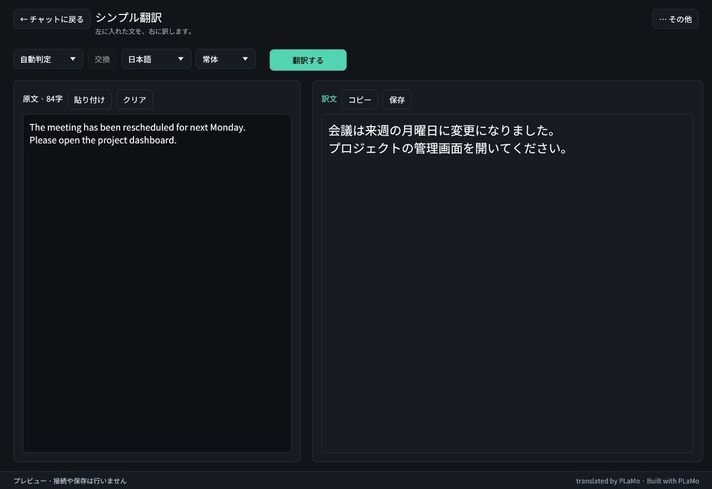

# Talk風Live翻訳

translated by PLaMo

Nemotron と PLaMo をこのPCで動かし、PCで再生中の英語の音声を、やさしい日本語にリアルタイムで訳してトーク風のチャットに出す、Windows用の翻訳アプリです。

**[Windows版のダウンロード](https://github.com/yebisu0529-ship-it/talk-style-live-translation/releases)** · **1.0.0**

https://github.com/user-attachments/assets/24994065-11f1-486d-a089-330682f25c6c

## できること

### ライブ翻訳

チャットの下の「● 聞く」を押すと、PCで再生中の英語の音声（マイクの音ではありません）を Nemotron Speech が聞き取り、PLaMo がやさしい日本語に訳して、メッセージアプリのような吹き出しで出します。話しているあいだも、訳を更新していきます。吹き出しを押すと、英語の原文が出ます。「■ 止める」で止まります（`Ctrl+Alt+L` でも同じです）。訳は履歴に残り（「⋯ その他」→「履歴」）、チャットの上の「全文コピー」でまとめてコピーできます。

### シンプル翻訳

チャットの上の「シンプル翻訳」（`Ctrl+1`）で開きます。左に入れた文が、右に訳で出ます。打ち終わって1秒たつと訳し、「翻訳する」か `Ctrl+Enter` ですぐに訳せます。訳は「コピー」でコピーできます。ライブ翻訳を止めずに使えます。

## オプション

必要なときだけ使う機能です。

- **YouTube字幕**：「YouTube字幕も訳す」をオンにすると、YouTubeの字幕（CC）も訳せます（初期値はオフ）。スイッチは、設定の「その他の機能」と、「⋯ その他」→「その他の機能」→「YouTube字幕の接続」の画面にあります。オンにすると、「⋯ その他」→「入力の切り替え」にYouTube字幕の入力が出ます。同梱の拡張機能を Chrome か Edge に読み込んで使います（手順は [extension/README.md](extension/README.md)）。
- **多言語の音声認識**：英語以外の言語（中国語など）のPC音声は、多言語の音声認識で聞き取ります。設定の「翻訳する言語」で翻訳元を選び、「音声認識」で Qwen3-ASR（GPU・数GB）か Whisper（CPU・約4GB）を選んで、「音声認識を準備」を押します。どちらも大きなダウンロードです。Nemotron は英語だけを聞き取ります。
- **ダークモード**：「⋯ その他」→「表示」の「ダークモード」で、チャットを暗い色にします（初期値はオフ）。
- **ミニ表示**（`Ctrl+Shift+M`）：同じチャットを小さな窓で読む表示です。上の行に「● 聞く」と、入るだけ「クリア」「全文コピー」「最前面」があります（入らないものは「⋯」の中です）。`Esc` で戻ります。
- **その他の機能**：「範囲翻訳」（`Ctrl+Alt+T`）、「画面の文字を翻訳」「画像から翻訳」「ファイルを翻訳」「字幕ウィンドウ」などは、「⋯ その他」→「その他の機能」にあります。読み上げと文字認識の設定は、設定の最後の「その他の機能」にあります。

## 動作環境

- Windows（x64）用です。翻訳は、NVIDIA の GPU（CUDA。ドライバー 551.61 以上）、Vulkan に対応した GPU、または CPU で動きます。
- 翻訳モデルは、0.8B・2B・8B・31B の4つの大きさから選びます。GPUの空きが 16 GiB 以上なら 8B、それより少なければ 2B が「おすすめ」になります。GPUのメモリやディスクの空きなどが足りない大きさは選べず、その理由がモデルを選ぶ画面に出ます。GPUのないPC（CPUかNPUだけのPC）では、0.8B だけを選べます。
- 確かめたのは、Windows 11 と RTX 4090 のPC 1台だけです。AMD と Intel の GPU、ほかのPCでは、まだ確かめていません（[検証範囲](docs/VALIDATION.md)）。

## はじめかた

1. [Releases](https://github.com/yebisu0529-ship-it/talk-style-live-translation/releases) から `talk-style-live-translation-1.0.0-win-x64.zip` をダウンロードし、好きなフォルダに展開します。
2. 展開したフォルダの `Talk風Live翻訳.cmd` を開きます（PythonやRustの事前導入は不要です）。
   - ※未導入のPCでは、翻訳エンジンの実行に [Microsoft Visual C++ 再頒布可能パッケージ（x64）](https://learn.microsoft.com/ja-jp/cpp/windows/latest-supported-vc-redist?view=msvc-170) が必要です。
3. 初回の画面で、翻訳モデルの大きさを選び、「はじめる」を押します。このPCに合う大きさが、最初から選ばれています。
   - 大きいほど自然に訳せますが、GPUのメモリを多く使います。モデルのダウンロード量は、0.8B が 546 MB、2B が 1.7 GB、8B が 4.9 GB、31B が 18.2 GB です。
   - 「はじめる」は、翻訳モデルとその実行環境、英語の文章区切り補助、英語の音声認識（Nemotron Speech）を、この順にダウンロードして準備します。保存先は、展開したフォルダの `data` です。
   - 取得する量の合計は、ボタンに出ます。下の画像は、GPUのメモリが 8 GB のPCで 2B を選んだ例です。翻訳モデルと実行環境が 2.3 GB、英語の音声認識が 689 MB、英語の文章区切り補助が 83 MB で、ボタンは「はじめる（合計 3.1 GB）」です。

   
4. 準備が終わると、チャットが開きます。「● 聞く」を押して、英語の動画や音声を再生します。

起動するたびに、翻訳モデルを読み込むあいだ、チャットのいちばん下に「準備中…」が出ます（RTX 4090 で 8B を読み込んだときは、約10秒でした）。「準備完了」になると、「● 聞く」を押せます。起動してはじめてPC音声を聞くときも、音声認識を読み込むあいだ「準備中…」が出ます。

## プライバシー

翻訳・音声認識・文字認識・読み上げは、すべてこのPCの中で動きます。モデルを最初にダウンロードするときのほかは、原文・画像・字幕・音声を外のサーバーへ送りません。

## 詳しい説明

- **[詳細仕様・動作要件・ライセンス](docs/SPECIFICATIONS.md)**：画面ごとの動き、モデル容量、対応GPUドライバー、ローカルポート、ビルド手順、各モデルのライセンス一覧
- **[YouTube拡張機能の導入手順](extension/README.md)**：ブラウザ拡張の読み込みと接続手順
- **[配布パッケージの構成・作成手順](docs/DISTRIBUTION.md)**：ポータブル版の構成とパッケージ作成方法
- **[検証範囲](docs/VALIDATION.md)**：確かめた動作の範囲と、まだ確かめていないこと

## ライセンスとクレジット

- **クレジット表記**：コピー・保存・本文ファイル翻訳の結果末尾には、PLaMo Community License 第5条に基づき `translated by PLaMo` / `Built with PLaMo` が自動で付きます（字幕ファイルは形式維持のため除外）。

アプリ本体のソースコードは [MIT License](LICENSE) です。  
翻訳モデル（[PLaMo Community License](https://plamo.preferredai.jp/info/plamo-community-license-ja)）やOCR・音声モデル・外部ランタイム・同梱フォントにはそれぞれの利用条件が適用されます。各コンポーネントのライセンスとリンク一覧は [docs/SPECIFICATIONS.md](docs/SPECIFICATIONS.md#9-モデルとライセンス) をご確認ください。
