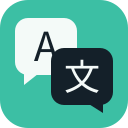
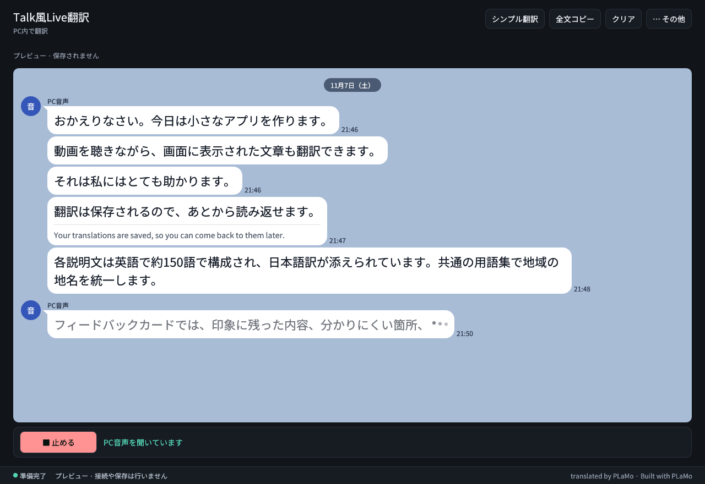
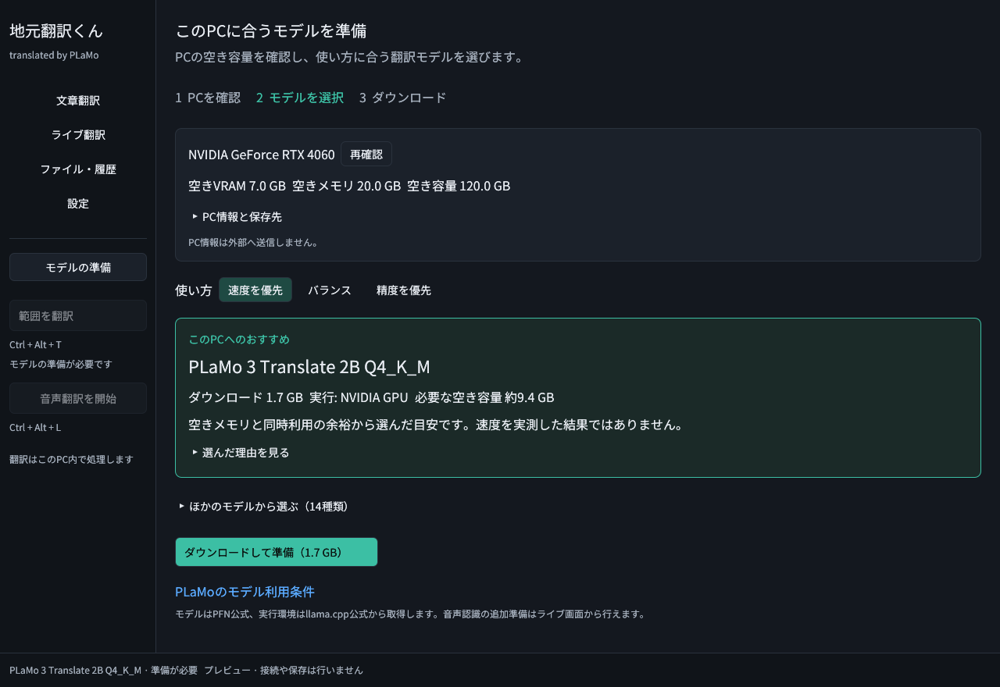

# Talk風Live翻訳

旧名：地元翻訳くん

translated by PLaMo

英語の音声やYouTube字幕を、このPC内でやさしい日本語にライブ翻訳し、トーク風のチャット画面に表示するWindows用ローカル翻訳アプリです。

**[Windows版のダウンロード](https://github.com/yebisu0529-ship-it/jimoto-honyaku-kun/releases)** · **プレビュー版 0.6.0**

## できること

- **ライブ翻訳（YouTube字幕・PC音声）**：短い字幕や音声を話のまとまり（段落）につないでリアルタイム翻訳。まとまりの長さは設定で短め・標準・長めから選べ、訳し終えた部分は固定されます。
  - **言いよどみを除く**：英語の字幕や音声では、「um」「uh」などの言いよどみを翻訳の前に取り除きます（原文の表示と履歴には残ります）。
  - **金利の分数を小数にする**：英語の字幕・音声・画面の文字では、「3 and 3/4」（YouTubeの自動字幕）や「3-3/4」（FOMCの声明）のような金利の分数を、翻訳の前に「3.75」のような小数に直します（原文の表示と履歴は分数のままです）。
  - **やさしい日本語**：翻訳先が日本語のとき、字幕・音声・画面のライブ翻訳は、やさしい日本語で表示します。PLaMoで日本語に訳したあと、その日本語をもう一度PLaMoでやさしい日本語に書き直します。履歴には、ふつうの日本語の訳も残ります。
  - **チャットで読む**：訳文はメッセージアプリのようなチャットに、古い順に上から下へ並びます。訳し終えた長い段落は、文の切れ目で約60字ごとの短い吹き出しに分かれます（時刻・原文・コピーは段落ごと）。吹き出しをクリックすると英語の原文が開き（YouTubeでは動画の位置も出ます）、右クリックでコピーできます。
  - **コピー**：吹き出しの文字はドラッグで選べ、`Ctrl+C` か右クリックの「選択範囲をコピー」で、選んだ部分だけをコピーできます。チャットの上の「全文コピー」では、表示中の会話をまとめてコピーできます。
- **金融（FOMC記者会見）の用語集**：設定の「用語集と文脈」で「金融（FOMC記者会見）の用語を入れる」を押すと、FRBの記者会見でよく出る30語（Federal Reserve = 連邦準備制度、federal funds rate = FF金利、Chair = 議長 など）を用語集の最後に足します。今ある行はそのまま残り、同じ原語は足しません。「設定を保存」を押すと翻訳に使われます。ほかの話題を訳すときは、足した行を消してください（たとえば Governor は州知事も「理事」と訳します）。
- **ミニ表示**：ミニ表示（`Ctrl+Shift+M`）は、同じチャットを小さな窓で読む表示です。上の行に「● 聞く」と、入るだけ「クリア」「全文コピー」「最前面」があります（入らないものは「⋯」の中です）。「最前面」で、ほかの窓より手前に置けます。
- **履歴**：これまでの訳文を、原文・訳文の言葉で検索できます。いまの会話の下には、「クリア」で消した会話が「これまでの会話」として会話ごとにたたんで並び、検索はそれらも探します。「書き出し」では、いまの会話をTXT・JSON・SRTに書き出せます。
- **完全ローカル実行**：翻訳・OCR・音声認識・読み上げはすべてPC内で完結し、外部へ送信しません。

## はじめかた

1. **起動する**：配布ZIPを展開し、`Talk風Live翻訳.cmd` を開きます（PythonやRustの事前導入は不要です）。
   - ※未導入のPCでは、翻訳エンジンの実行に [Microsoft Visual C++ 再頒布可能パッケージ（x64）](https://learn.microsoft.com/ja-jp/cpp/windows/latest-supported-vc-redist?view=msvc-170) が必要です。
2. **「はじめる」を押す**：初回画面で、0.8B・2B・8B・31B の大きさを選びます。大きいほど自然に訳せますが、GPUのメモリを多く使います。GPUメモリのグラフに、いまの使用量と、選んだモデルが足す量が出ます。このPCに合う大きさが最初から選ばれているので、そのまま「はじめる」を押せます。ボタンには、これから取得する量の合計が出ます。その上の「ダウンロードするもの」に、取得するものとそれぞれの大きさ、保存先（ZIPを展開したフォルダの `data`）が出ます。
   - 押すと、翻訳モデル、英語の文章区切り補助（チェックを外すと省きます）、英語のPC音声の認識（Nemotron Speech）を、順に準備します。「2/3 英語の文章区切り補助を準備中」のように、いまの段階が出ます。
   - 「中止」で止められます。途中で失敗しても、できたところは残ります。「もう一度」で、失敗したところから続けられます。
   - GPUのメモリに入らない大きさは選べません。GPUがないPC（CPUかNPUだけのPC）では、0.8Bだけを選べます。

   
3. **使い始める**：準備が終わると、チャットが開きます。下の「● 聞く」を押すと翻訳が始まり、「■ 止める」を押すと止まります（`Ctrl+Alt+L` でも同じです）。最初は、PCで再生中の音声を訳します。準備が終わっただけでは、音声の取得は始まりません。

## 画面の構成

起動すると、翻訳が流れる**チャット**が開きます（翻訳モデルが入っていないときだけ、先にモデルの画面が開きます）。翻訳は、チャットの下の「聞く」ボタンで始めたり止めたりします。ほかの機能は、右上の「⋯ その他」にまとめています。

| 開きたいもの | 開きかた |
| --- | --- |
| ミニ表示 | 「その他」→「ミニ表示」（`Ctrl+Shift+M`） |
| 履歴（検索・書き出し・「クリア」で消した会話） | 「その他」→「履歴」（`Ctrl+3`） |
| YouTube字幕の接続（拡張機能の入れ方・接続キー・つながっているか） | 「その他」→「その他の機能」→「YouTube字幕の接続」 |
| モデルの準備・変更 | 「その他」→「モデル」 |
| 設定 | 「その他」→「設定」（`Ctrl+4`） |
| 翻訳する言語 | 「その他」→「設定」の、いちばん上の「翻訳モデル」の中 |
| 準備の状態 | 「その他」→「状態の詳細」 |
| 「聞く」が訳す入力の選び直し（PC音声だけ。「YouTube字幕も訳す」がオンなら、YouTube字幕だけ・自動も） | 「その他」→「入力の切り替え」（チャットだけ。ミニ表示では「⋯」の中） |
| 会話を消して新しく始める・書き出し・文字サイズ（チャットだけ） | チャットの「クリア」ボタン、「その他」→「書き出し」「表示」（消した会話は、履歴の「これまでの会話」に残ります。「書き出し」は、いまの会話だけを書き出します） |
| 文章・画像・ファイルの翻訳、画面の範囲や文字の翻訳、字幕ウィンドウ、読み上げ | 「その他」→「その他の機能」（下の「[その他の機能](#その他の機能)」を参照） |

チャット以外の画面では、左上の「← チャットに戻る」（`Ctrl+2`）でチャットへ戻れます。

## 主なショートカット・状態表示

| 操作 | ショートカット / 場所 |
| --- | --- |
| 聞く / 止める（チャットの下のボタン、ミニ表示の上のボタンと同じ） | `Ctrl+Alt+L` |
| ミニ表示に切り替え / 戻る | `Ctrl+Shift+M`（ミニ表示中は `Esc` でも戻る） |
| チャット・履歴・設定を開く | `Ctrl+2`〜`Ctrl+4`（`Tab` で操作部品を選び、`Enter` / `Space` で押す） |

- **「聞く」の横の一行**：止まっているときは「止まっています」、動いているときは「YouTube字幕を受け取っています」「PC音声を聞いています」のように、いま何を訳しているかが出ます。翻訳モデルがないあいだは「聞く」を押せず、そう書きます。サービスのエラーは、この一行に赤で出ます。ミニ表示では、同じ一行をいちばん下に出します。
- **モデルの準備状態**：チャットのいちばん下の行の左に、状態がひとつ表示されます。「準備完了」「準備中…」「準備が必要です」のどれかで、「準備が必要です」のときは、横の「モデルの準備」でモデルの画面が開きます。音声認識などは、はじめて使うときに準備するので、まだ準備していなくても「準備完了」のままです。
- **状態の詳細**：「その他」→「状態の詳細」で、「翻訳」「音声認識」「文字認識」の状態を1行ずつ見られます（「読み上げを使う」がオンのときは「読み上げ」も）。準備完了は `●`、それ以外は `○` に「未準備」または「準備中」を添え、使っているモデルや方式の名前も出します。未準備の行を押すと、準備する画面が開きます。「文字認識」と「読み上げ」の行では、設定が開き、「その他の機能」の中のその項目まで進みます。
- **クレジット表記**：コピー・保存・本文ファイル翻訳の結果末尾には、PLaMo Community License 第5条に基づき `translated by PLaMo` / `Built with PLaMo` が自動で付きます（字幕ファイルは形式維持のため除外）。

## YouTube字幕とPC音声の準備

ライブ翻訳が訳すYouTube字幕とPC音声は、次のように準備します。

- **YouTube字幕連携**：YouTube字幕はオプションです。設定の「その他の機能」か「YouTube字幕の接続」の画面で「YouTube字幕も訳す」をオンにすると、「入力の切り替え」で「YouTube字幕だけ」か「自動（字幕を優先）」を選べます。同梱の `extension` フォルダを Chrome / Edge に読み込み、アプリの接続キーを設定すると表示中のCC字幕を翻訳します。手順は「その他」→「その他の機能」→「YouTube字幕の接続」の画面にあり、拡張機能とつながったか、接続キーが違うか、字幕が届いているかもそこに出ます（[extension/README.md](extension/README.md) にも同じ手順があります）。拡張機能を入れる前から開いていたYouTubeのページは、再読み込みします。拡張機能のファイルを新しくしたときは、`chrome://extensions`（Edgeは `edge://extensions`）で拡張機能の再読み込みボタンを押し、そのあと、開いているYouTubeのページも再読み込みします。YouTubeの窓を最小化したときなどは、YouTubeが字幕の表示を止めるため、字幕が届きません。「入力の切り替え」が「自動（字幕を優先）」なら、そのあいだはPC音声を訳し、字幕が動き出すと字幕に戻ります。
- **PC音声の認識（STT）**：英語向けの軽量な **Nemotron Speech** は、初回の「はじめる」で準備します。多言語対応の **Qwen3-ASR**（CUDA）や **Whisper**（CPU）は、設定で選ぶと追加できます。Nemotron は英語だけを聞き取ります。中国語など、ほかの言語のPC音声を訳すときは、設定の「翻訳する言語」で翻訳元を選び、「音声認識」で Qwen3-ASR（GPU・数GB）か Whisper（CPU・約4GB）を選びます。Nemotron のままほかの言語を選ぶと、「聞く」はPC音声を始めず、そのことを「聞く」の横に出します。

## その他の機能

入力した文章や画面の選択範囲も、このPC内で翻訳できます。ライブ翻訳のほかの機能は、右上の「⋯ その他」→「その他の機能」と、設定の最後の「その他の機能」にまとめています。メニューの「その他の機能」には、文章を翻訳・範囲翻訳・画面の文字を翻訳・ファイルを翻訳・字幕ウィンドウ・YouTube字幕の接続があり、モニターが2つ以上あるときは画面選択も出ます。ミニ表示の「⋯」→「その他の機能」には、範囲翻訳・画面選択・字幕ウィンドウがあります。設定の「その他の機能」は最初は閉じていて、開くと「訳文の読み上げ」「画面・画像の文字認識」「YouTube字幕」があります。

- **文章・画像・ファイル翻訳**：テキスト入力、画像ドロップ、TXT / Markdown / SRT / WebVTT ファイルの翻訳に対応。「その他の機能」→「文章を翻訳」（`Ctrl+1`）で文章の画面を開き、「翻訳する」か `Ctrl+Enter` で訳します。文章の画面の上の「画像から翻訳」と「ファイルを翻訳」でも訳せます。「ファイルを翻訳」は「その他の機能」にもあり、進み具合と「中止」は文章の画面に出ます。
- **画面の範囲翻訳（OCR）**：`Ctrl+Alt+T` か「その他の機能」→「範囲翻訳」で、画面の好きな場所をドラッグしてそのまま翻訳（`Esc` で中止）。`Ctrl+Alt+T` や画像のドロップで読み取った文字は、文章の画面で訳します。チャットを見ているときは、読み取りが終わったところで文章の画面に切り替わり、ライブ翻訳は止まりません。ミニ表示のときは、画面を替えずに、チャットの場所に「訳文」のカードを出します。カードの「← チャットに戻る」で、チャットに戻ります。モニターが2つ以上あるときは、「その他の機能」の「画面選択」で、読み取る画面を選べます。
- **画面を読み続ける翻訳**：「その他の機能」→「画面の文字を翻訳」で範囲をドラッグすると、その範囲を一定の間隔（設定の「画面・画像の文字認識」で1〜3秒）で読み取り、文字が変わったときだけ翻訳します。画像はメモリ上だけで扱い、ファイルには保存しません。「画面の文字」を選んでいるあいだは、「入力の切り替え」にも「画面の文字」が出て、ほかの入力に切り替えられます。
- **字幕ウィンドウ**：「その他の機能」→「字幕ウィンドウ」で、独立した字幕専用ウィンドウを開けます。字幕ウィンドウは、いまの入力の訳文を、チャットと同じ並びで表示します。
- **日本語の読み上げ**：翻訳された日本語を固定声で再生（手動再生・ライブ自動読み上げ）。設定の「その他の機能」の「訳文の読み上げ」で「読み上げを使う」をオンにしたときだけ表示されます（既定はオフ）。**Irodori-TTS** を導入すると、標準の固定声や手元の参照音声（WAV）から登録した声で訳文を読み上げられます。「自動読み上げ」は、チャットでは下のバーの「聞く」の横、ほかの画面では右上の「その他」の左にあります（ミニ表示では上の行）。オフにすると読み上げ中の文も止まります。
- **文字認識の方式**：設定の「その他の機能」の「画面・画像の文字認識」で選びます。標準の **Windows OCR** のほか、軽量な **Indra OCR**（CPU）、高精度な **PaddleOCR-VL-1.6** を追加できます。

## 詳細ドキュメント

詳しい仕様やライセンス条件、開発・検証に関する情報は別ドキュメントにまとめています。

- **[詳細仕様・動作要件・ライセンス](docs/SPECIFICATIONS.md)**：モデル容量、対応GPUドライバー、ローカルポート、ビルド手順、各モデルのライセンス一覧
- **[YouTube拡張機能の導入手順](extension/README.md)**：ブラウザ拡張の読み込みと接続手順
- **[配布パッケージの構成・作成手順](docs/DISTRIBUTION.md)**：ポータブル版の構成とパッケージ作成方法
- **[検証範囲](docs/VALIDATION.md)**：0.6.0 までに確認した動作範囲と未検証項目

## ライセンス

アプリ本体のソースコードは [MIT License](LICENSE) です。  
翻訳モデル（[PLaMo Community License](https://plamo.preferredai.jp/info/plamo-community-license-ja)）やOCR・音声モデル・外部ランタイム・同梱フォントにはそれぞれの利用条件が適用されます。各コンポーネントのライセンスとリンク一覧は [docs/SPECIFICATIONS.md](docs/SPECIFICATIONS.md#9-モデルとライセンス) をご確認ください。
